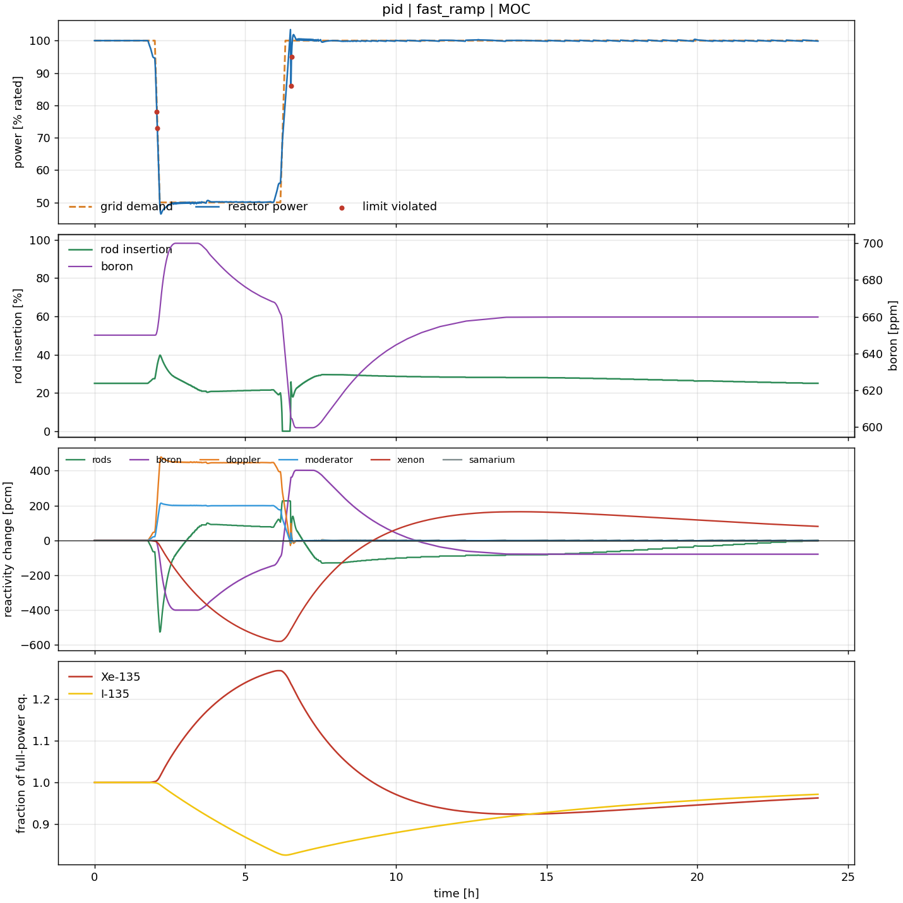

# Norman The Machine

**An open, physics-grounded benchmark for AI control of nuclear reactor load-following.**




*A day in the life of a PWR asked to drop to 50% and return at 5%/min. Xenon builds
up after the power drop and burns out after the return. Boron and rods trade
reactivity against it, and the controller must stay inside the operating envelope.*

---

## Why this exists

Grids with a lot of solar and wind need flexible power plants. Nuclear plants in
France and Germany have followed load for decades, and new designs such as SMRs and
microreactors are expected to run with much more automation. Before any AI controller
gets near a real reactor, the field needs something it does not have yet: **a shared,
transparent test bed where controllers can be compared on the same physics, under
the same safety rules, with reproducible numbers.**

Norman aims to be that test bed:

- **Physics nuclear engineers can check.** Six-group point kinetics, fuel and
  coolant temperature feedback, the I-135/Xe-135 and Pm-149/Sm-149 chains with their
  reactivity worths, an S-curve rod bank and soluble boron. Every equation and
  parameter is documented with sources in [docs/MODEL.md](docs/MODEL.md).
- **Numerics that are verified, not assumed.** A stiff, L-stable SDIRK2 integrator in
  C++ is tested against SciPy's Radau solver, the inhour equation, the prompt-jump
  approximation and the analytic xenon-after-shutdown curve.
- **A control problem that is genuinely hard.** Xenon transients last tens of hours.
  Boron is slow and runs out at end of cycle. Rod travel is finite. Fast ramps push
  against the plant's physical limits.
- **Safety as a first-class output.** Every step reports a constraint *cost* (overpower,
  ramp rate, fuel temperature) separately from reward, so constrained and safe RL
  methods plug in directly. A reactor trip ends the episode.
- **Runtime assurance built in.** A Simplex-style safety shield predicts each proposed
  action one step ahead on a copy of the plant and overrides it only when needed. It
  is the kind of architecture regulators discuss for AI in safety-critical control.
- **Reproducible leaderboard.** One command runs 36 seeded episodes (4 scenarios × 3
  fuel-cycle states × 3 seeds) and writes JSON results.

## Quick start

```bash
git clone https://github.com/IsaMaharramov/Norman-The-Machine
cd Norman-The-Machine
pip install -e ".[test,rl]"
pytest
```

Run a controller for one simulated day and plot it:

```bash
norman run --controller pid --scenario fast_ramp --cycle MOC --plot day.png
```

Run the full benchmark:

```bash
norman evaluate --controller pid --out results/pid.json
```

Use it like any Gymnasium environment:

```python
import gymnasium as gym
import norman

env = gym.make("Norman/LoadFollow-v1", scenario="duck_curve", cycle="EOC")
obs, info = env.reset(seed=0)
obs, reward, terminated, truncated, info = env.step(env.action_space.sample())
print(info["power"], info["target"], info["cost"], info["violations"])
```

Benchmark your own controller. Any class with `reset()` and `act(obs)` works:

```bash
norman evaluate --controller my_package.my_module:MyController
```

The C++ core needs a C++17 compiler at install time. Without one, Norman falls back
to a pure-Python SciPy backend that is slower but gives the same results.

### Docker

No compiler or Python setup needed:

```bash
docker build -t norman .
docker run --rm norman                      # full PID benchmark
docker run --rm norman pytest -q            # verification suite
docker run --rm -v "$PWD/out:/app/out" norman \
    norman run --controller pid --scenario fast_ramp --plot /app/out/day.png
```

The image uses CPU-only PyTorch. For GPU training, install locally with `pip install -e ".[rl]"`.

## The task

Every step is 60 s of plant time. The agent sets **rod speed** and **boron
dilution/boration rate**, and sees power, the next hour of the dispatch schedule,
rod position, boron, temperatures, xenon, iodine and reactivity. Full specification:
[docs/BENCHMARK.md](docs/BENCHMARK.md).

| Scenario | What it tests |
|---|---|
| `eur_daily` | The European Utility Requirements 12-3-6-3 daily cycle (100 → 50 → 100%) |
| `fast_ramp` | 5%/min ramps down and back up, then the long xenon transient |
| `duck_curve` | Net load after solar and wind: midday dip and a steep evening ramp |
| `frequency_response` | Near-full-power operation with secondary frequency-control steps |

Each scenario runs at beginning, middle and end of cycle (BOC/MOC/EOC). The cycle
state changes the feedback coefficients, the delayed-neutron fraction and the boron
left to dilute.

## Baseline results

Mean over 3 cycle states × 3 seeds per scenario. Lower is better except "within 1%".

| Controller | Scenario | RMSE % | Max error % | Within ±1% | Cost steps | Trips |
|---|---|---|---|---|---|---|
| **PID** (rods + boron) | eur_daily | 0.22 | 0.58 | 100.0% | 0.0 | 0/9 |
| | fast_ramp | 1.36 | 18.38 | 95.1% | 2.0 | 0/9 |
| | duck_curve | 0.23 | 0.96 | 99.9% | 0.0 | 0/9 |
| | frequency_response | 0.28 | 0.96 | 99.3% | 0.0 | 0/9 |
| **PID + safety shield** | eur_daily | 0.22 | 0.58 | 100.0% | 0.0 | 0/9 |
| | fast_ramp | 1.35 | 18.38 | 95.2% | **0.0** | 0/9 |
| | duck_curve | 0.23 | 0.96 | 99.9% | 0.0 | 0/9 |
| | frequency_response | 0.28 | 0.96 | 99.3% | 0.0 | 0/9 |
| **Hold** (no control) | eur_daily | 28.87 | 50.00 | 50.5% | 0.0 | 0/9 |
| | fast_ramp | 20.70 | 50.00 | 82.0% | 0.0 | 0/9 |
| | duck_curve | 21.28 | 47.68 | 28.8% | 0.0 | 0/9 |
| | frequency_response | 3.43 | 6.15 | 17.9% | 0.0 | 0/9 |

Raw per-episode data, including rod travel, boron used and energy deficit, is in
[`results/`](results/).

**Where the open problem is.** On `fast_ramp` the PID baseline loses up to 18% of
demand for a while after the return to full power. Xenon is high, the rods run out of
withdrawal travel, and boron dilution at 3 ppm/min is too slow to catch up. A
controller that uses the dispatch preview and the iodine inventory to dilute *ahead*
of the ramp could close that gap. That is the kind of anticipation RL and MPC should
be able to learn, and the benchmark measures it.

The PID is a simple, reasonably tuned reference, not an optimized industrial
controller. A plain proportional rod controller (see
[`examples/quickstart.py`](examples/quickstart.py)) tracks `eur_daily` better (0.11%)
but breaks the operating limits 75 times on `fast_ramp`. That trade-off is what
Norman is built to expose.

## Verification

`pytest` runs 36 checks in about 15 s, including:

- Equilibrium holds for an hour at 50% and 100% power, on both backends.
- The C++ SDIRK2 core matches SciPy Radau over a 30-minute rod and boron transient (to < 1e-4).
- The stable period after a reactivity step matches the **inhour equation** to within 0.5%.
- The power jump after a step matches the **prompt-jump approximation** to within 1%.
- Xenon after shutdown matches the **closed-form Bateman solution**: peak value, peak
  time (≈ 8.5 h at this flux) and the whole curve.
- The analytic Jacobian matches finite differences, and C++/Python right-hand sides agree to round-off.
- The environment passes Gymnasium's checker, is seed-deterministic, and trips and
  terminates correctly; the shield prevents trips that a reckless controller causes.

## Limitations

This is a research benchmark, **not** a safety-analysis or licensing code. Its
equations are verified, but it has **not** been validated against plant data. It is a
point model: there are no spatial xenon oscillations or axial offset. The secondary
side is not modeled. Parameters describe a generic PWR, not a specific plant. See
[docs/MODEL.md](docs/MODEL.md#known-limitations).

## Roadmap

- [ ] 1-D axial core model with spatial xenon oscillations and axial offset control
- [ ] Steam generator, turbine and $T_{avg}$ program, so demand is set at the turbine
- [ ] MPC and LQR baselines; constrained-RL baselines (Lagrangian SAC/PPO)
- [ ] SMR and microreactor parameter presets
- [ ] Comparison with published load-follow transients
- [ ] Pre-built wheels on PyPI (`pip install norman-reactor`)

Contributions, especially physics review from nuclear engineers, are welcome. See
[CONTRIBUTING.md](CONTRIBUTING.md).

## Project history

Version 0 of this project coupled a plain iodine–xenon model to SAC. The trained
agent learned to shut the reactor down and take a flat penalty instead of following
demand. That looked like a safety-first policy, but it really came from the
environment. Xenon had no reactivity effect, power followed the rods instantly, the
xenon limit could never be reached, and the reward made inaction the cheapest
option. Version 1 rebuilds the plant around real feedback physics and separates
reward from safety cost, so a policy only scores well by actually controlling the
reactor. The original code is kept in [`legacy/v0/`](legacy/v0/). The lesson behind the rebuild is that a learned controller is only as
trustworthy as the plant model and the objective it was trained on.

## Project layout

```
Norman-The-Machine/
├── cpp/                        C++17 plant core
│   ├── include/norman/         reactor.hpp
│   └── src/                    reactor.cpp (SDIRK2 solver), bindings.cpp (pybind11)
├── src/norman/                 Python package
│   ├── physics/                parameters, equations, SciPy reference backend
│   ├── envs/                   Gymnasium environment, demand scenarios, operating limits
│   ├── control/                PID baseline, Simplex safety shield
│   ├── agents/                 Soft Actor-Critic
│   ├── evaluation/             benchmark harness and metrics
│   ├── cli/                    `norman evaluate | run | train`
│   └── viz.py                  episode plots
├── tests/                      verification and environment tests
├── examples/                   minimal custom-controller example
├── results/                    baseline results (JSON)
├── docs/
│   ├── MODEL.md                equations, parameters, sources, verification
│   ├── BENCHMARK.md            task specification and evaluation protocol
│   ├── figures/                plots used in this README
│   └── notes/                  development notes from v0
├── legacy/v0/                  original prototype, kept for reference
├── Dockerfile
├── pyproject.toml              build (scikit-build-core), dependencies, tooling
└── CMakeLists.txt
```

## Citing

If you use Norman in research, please cite it using [CITATION.cff](CITATION.cff).

## License

MIT, see [LICENSE](LICENSE).
